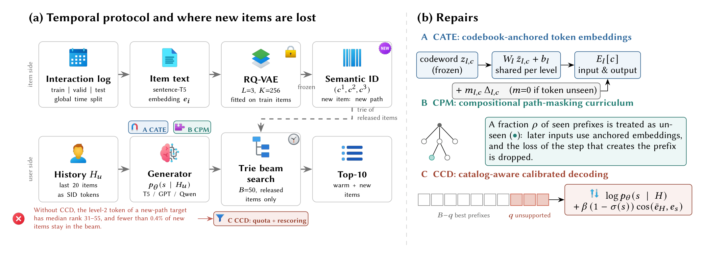
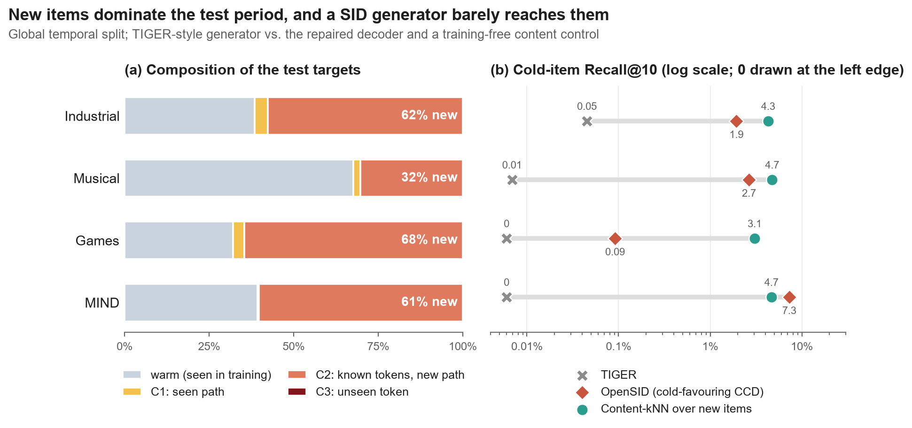
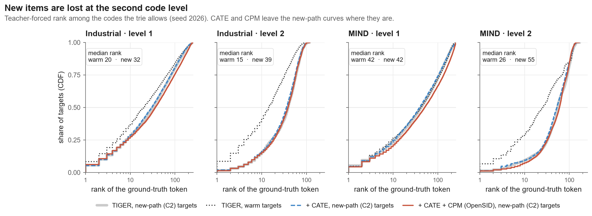
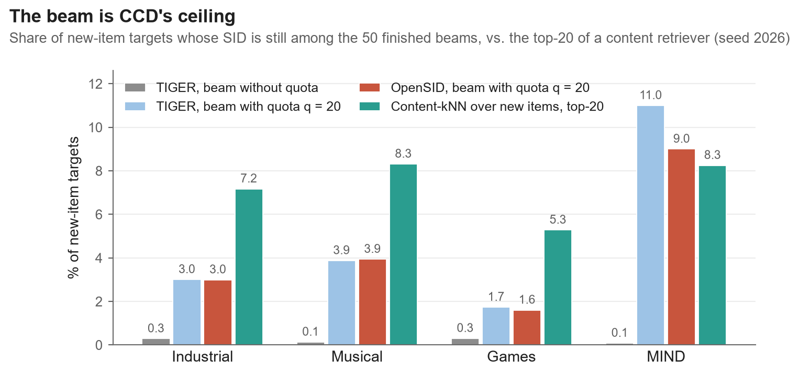
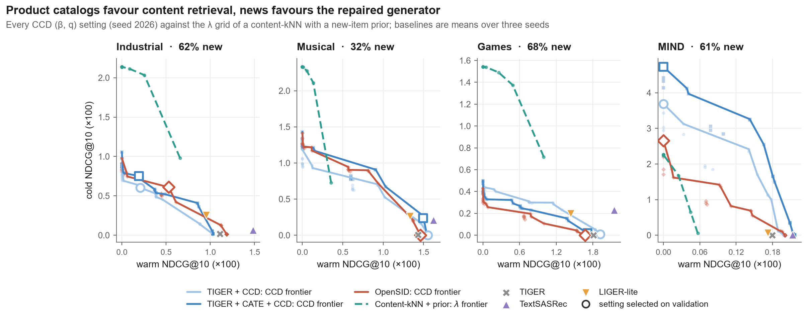
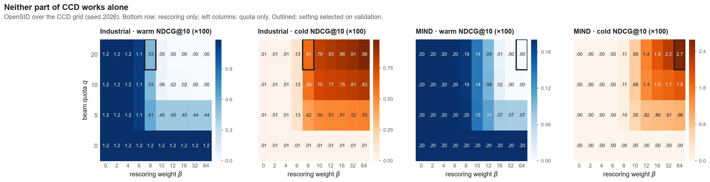
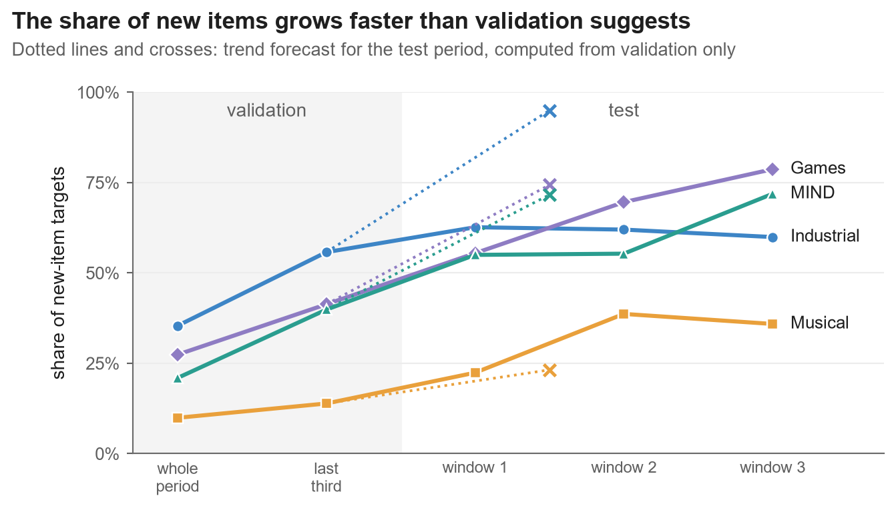

<div align="center">

<h1>Reaching the Future Catalog</h1>

<p><b>Locating and repairing new-item loss in Semantic-ID recommenders</b></p>

<p>


</p>

<p>
<a href="#results">Results</a> ·
<a href="#method">Method</a> ·
<a href="#getting-started">Getting started</a> ·
<a href="#reproducing-the-paper">Reproducing the paper</a> ·
<a href="#repository-layout">Layout</a>
</p>

</div>

<br>

Web catalogs change every day. Marketplaces list new products and news sites publish new articles by the hour.
Generative recommenders that decode items as Semantic IDs (SIDs) should be able to recommend these items without
retraining, since any item with a description can be tokenized. We tested that under a global temporal split on
three Amazon Reviews 2023 domains and MIND, and found that a TIGER-style generator almost never recommends a new item.
This repository contains the protocol, the diagnosis, the repairs (OpenSID) and the stored results of all 223 runs.

<p align="center"></p>

<table align="center">
<tr>
<td align="center" width="25%"><h2>32–68%</h2>of test targets are new items</td>
<td align="center" width="25%"><h2>93–99%</h2>of those reuse known tokens on a new path</td>
<td align="center" width="25%"><h2>&lt;0.4%</h2>of new items survive TIGER's beam search</td>
<td align="center" width="25%"><h2>0.07 → 2.6</h2>NDCG@10 (×100) on MIND with CCD, no retraining</td>
</tr>
</table>

## What we found

New items fail at a specific place. The first code of a new item ranks about as well as that of an item seen in
training. The second code ranks 31st to 55th in median (9th to 26th for seen items), and beam search with 50 beams
then drops more than 99.6% of the new items before the last code is generated.

A decoder change recovers most of the loss without any training. CCD keeps a few beam slots for SID prefixes that
no training item supports and rescores the finished beams by content similarity. Cold-item Recall@10 goes from at
most 0.05% to 1.1–1.6% on Industrial and to 7.3–8.2% on MIND. The quota alone gets new items into the beam but not
into the top 10; the rescoring alone has nothing to rerank. Both parts are needed.

Whether a generator should serve new items depends on the domain. On news, the repaired beam reaches 9–11% of the
new items and beats a content retriever with a new-item prior. On product catalogs, the content retriever finds
5.3–8.3% of them in its top 20 against 1.6–3.9% for the beam, and it is the better choice.

## Results

Test period, values ×100. Trained models are averaged over seeds 2026–2028; the training-free kNN rows are single
runs. N@10 is overall NDCG@10 and cold R@10 is Recall@10 on new-item targets. The best value per column is in bold.

| Method | Industrial N@10 | Industrial cold R@10 | Musical N@10 | Musical cold R@10 | Games N@10 | Games cold R@10 | MIND N@10 | MIND cold R@10 |
|---|---:|---:|---:|---:|---:|---:|---:|---:|
| Content-kNN | 0.86 | 1.88 | 0.48 | 1.48 | 0.81 | 1.51 | 0.06 | 0.12 |
| Content-kNN + new-item prior | **1.31** | **4.27** | 0.77 | **4.23** | **1.10** | **2.95** | 1.37 | 4.66 |
| SASRec | 0.37 | 0.00 | 0.74 | 0.00 | 0.37 | 0.00 | 1.07 | 0.00 |
| TextSASRec | 0.61 | 0.18 | **1.17** | 0.44 | 0.84 | 0.58 | 0.09 | 0.02 |
| TIGER | 0.44 | 0.05 | 0.97 | 0.01 | 0.58 | 0.00 | 0.07 | 0.00 |
| LIGER-lite | 0.52 | 0.65 | 0.99 | 0.69 | 0.60 | 0.50 | 0.11 | 0.19 |
| TIGER + CCD | 0.52 | 1.13 | 0.97 | 0.01 | 0.58 | 0.00 | **2.60** | **8.19** |
| TIGER + CATE + CCD | 0.58 | 1.58 | 1.00 | 0.19 | 0.58 | 0.02 | 2.36 | 7.78 |
| OpenSID (CATE + CPM + CCD) | 0.56 | 1.42 | 1.00 | 0.14 | 0.60 | 0.01 | 2.14 | 7.29 |

The CCD setting is chosen on the validation period by overall NDCG@10. Validation has few new items on Musical and
Games, so this rule turns CCD off there for two of the three seeds (see the last figure below). The full tables,
with every bucket, standard deviations, ablations, backbones, incremental updates, sensitivity and the
leave-one-out protocol, are in `results/summary.md`.

<p align="center"></p>

<p align="center"></p>

<p align="center"></p>

<details>
<summary><b>More figures: trade-off curves, the CCD grid, and the drift of the new-item share</b></summary>
<br>
<p align="center"></p>
<p align="center"></p>
<p align="center"></p>

Overall NDCG@10 equals $(1-\pi)\,\mathrm{N}_{\mathrm{warm}} + \pi\,\mathrm{N}_{\mathrm{cold}}$, where $\pi$ is the
share of new items, and $\pi$ is much higher in the test period than in validation. `opensid/evaluate.py` contains
the selection rules we compared (last window, trend forecast, warm guard, balanced) next to the default.
</details>

## Method

OpenSID keeps the tokenizer frozen and changes three things, each of which can be switched on separately.

**CATE** ties every token embedding to its RQ-VAE codeword,
$E_l[c] = W_l\,\bar z_{l,c} + b_l + m_{l,c}\,\Delta_{l,c}$. The residual $\Delta$ is masked for tokens that never
occur in training, so their logits come from content. It adds 12,672 parameters to a 4.56M-parameter model.

**CPM** marks a growing share of seen prefixes (up to 20%) as unseen during training. Later decoder inputs then use
the anchored embeddings, and the loss of the step that creates the prefix is dropped.

**CCD** works at inference time only. It reserves $q$ of the $B$ beam slots for prefixes without training support
and orders the finished beams by $\log p_\theta(s\mid H) + \beta\,(1-\sigma(s))\cos(\bar e_H, e_s)$, where
$\sigma(s)$ is the supported share of the path. $\beta$ and $q$ are picked on validation.

Every method may recommend only items released before the interaction; the beam search prunes trie prefixes whose
items are all unreleased. Targets are split into warm items, C1 (seen path), C2 (known tokens, new path) and C3
(unseen token), and Reach@Beam is the share of new-item targets whose SID is among the finished beams.

## Getting started

```bash
conda create -n opensid python=3.11 -y
conda activate opensid
pip install torch --index-url https://download.pytorch.org/whl/cu121   # choose the build for your CUDA
pip install -r requirements.txt
```

The metrics of every run are included, so the tables and figures can be rebuilt on a laptop in a few seconds:

```bash
python -m opensid.aggregate        # results/summary.md and results/main_table.csv
python scripts/make_figures.py     # assets/*.png, assets/*.pdf and assets/results.md
```

To train and evaluate single models:

```bash
python -m opensid.download                                # data/raw, honours HF_ENDPOINT
python -m opensid.prepare --dataset amazon_industrial     # split, embeddings, RQ-VAE tokenizer
python -m opensid.train_gen --dataset amazon_industrial --exp tiger   --emb standard --cpm 0
python -m opensid.train_gen --dataset amazon_industrial --exp opensid --emb cate     --cpm 1
python -m opensid.cold_knn  --dataset amazon_industrial   # new-item kNN controls
python -m opensid.hybrid    --dataset amazon_industrial --gen_exp opensid --gen_rank ccd_overall \
                            --content_exp knn_newprior --exp hybrid_knnprior_opensid
```

A run writes `results/<dataset>/<exp>/metrics.json`. Plain decoding is under `test_plain`, the selected CCD
setting under `test_ccd_overall`, and the whole CCD grid under `ccd_grid_valid` and `ccd_grid_test`. The run also
saves its rankings (`rank_*.npy`), the checkpoint (`best.pt`) and an empty `done` file.

## Reproducing the paper

```bash
CUDA_VISIBLE_DEVICES=0,1 nohup python run_all.py > run.log 2>&1 &
python run_all.py --quick --datasets amazon_industrial    # main methods, one seed
```

`run_all.py` downloads the data, builds the 225 jobs listed in `opensid/experiments.py` and runs them one per GPU in
dependency order. If it stops, start it again: finished jobs are skipped. `logs/_status.json` shows what is running.

| Experiment | Runs | Datasets |
|---|---|---|
| Main comparison and module ablation | Pop, Recent-Pop, Content-kNN, new-item kNN controls, SASRec, TextSASRec, TIGER, LIGER-lite, SpecGR-lite, rank-fusion hybrids, TIGER + CCD, CATE, CPM; three seeds for trained models | Industrial, Musical, Games, MIND |
| Design alternatives | no $\Delta$ masking, CPM keeps the extension loss, tokenizer refitted on all items | all four |
| Backbones | T5, GPT, Qwen2.5-0.5B | Industrial, Musical |
| Incremental update | no update, full fine-tune, retrain, CATE projections only | Industrial, MIND |
| Sensitivity | $\rho_{\max} \in \{0.1, 0.2, 0.4\}$, $K \in \{128, 256, 512\}$ | Industrial |
| Protocol comparison | leave-one-out split | Industrial |

The data are [Amazon Reviews 2023](https://amazon-reviews-2023.github.io/) (Industrial & Scientific, Musical
Instruments, Video Games, 5-core) and [MIND-small](https://msnews.github.io/). Amazon interactions are split at the
80% and 90% time quantiles and MIND at 70% and 85%. Test and validation targets are subsampled to 30k and 10k with a
fixed seed. An item counts as released at its first interaction.

On one GPU, a T5 generator trains in 6 to 44 minutes, the GPT backbone in 16 to 47 minutes and Qwen2.5-0.5B in about
80 minutes (it needs 24 GB). SASRec and TextSASRec take 1 to 3 minutes. The CCD grid adds one beam search per quota
value. Checkpoints and rankings (about 24 GB) are not part of the repository.

## Repository layout

```
run_all.py                  runs all 225 jobs, resumable
configs/default.yaml        hyper-parameters
opensid/
  download.py, preprocess.py, embed.py, rqvae.py, prepare.py     data, temporal split, tokenizer
  sid.py                    SID catalog, prefix trie, training support, warm/C1/C2/C3 buckets
  models/embeddings.py      CATE and the standard token embedding
  models/generative.py      T5, GPT and Qwen2.5-0.5B generators, LIGER dense head
  train_gen.py              generator training, CPM, CCD grid, token-rank analysis
  decode.py                 time-aware constrained beam search, CCD quota and rescoring
  evaluate.py               bucketed metrics, Reach@Beam, operating-point rules
  train_seq.py              SASRec and TextSASRec
  simple_baselines.py       Pop, Recent-Pop, Content-kNN
  cold_knn.py               new-item kNN controls
  hybrid.py, specgr.py      rank fusion, SpecGR-lite
  experiments.py            every experiment of the paper
  scheduler.py, runtime.py  multi-GPU job scheduler, environment checks
  aggregate.py, analysis.py summary tables, significance tests, similarity quintiles
scripts/make_figures.py     figures and the results table of this README
results/<dataset>/<exp>/    metrics.json of all 223 runs, token ranks of the main models
data/processed/<dataset>/   split statistics
assets/                     figures
```


## License

The code is under the MIT license. Amazon Reviews 2023 and MIND keep their own licenses. The icons in the overview
figure come from [Icons8](https://icons8.com).
